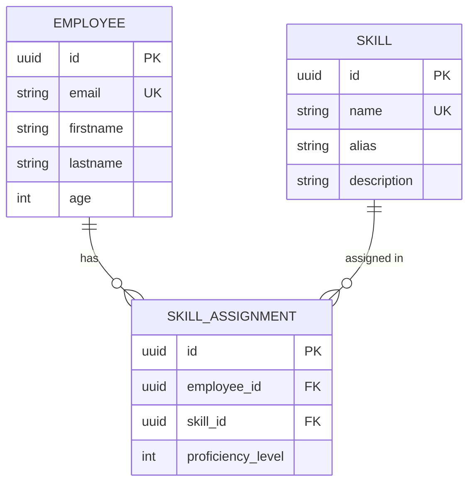

# Basics

Take Home Assignment, 1 Person

## Requirements given by the company

Build a working web application with the following capabilities:

1. Employee import: A team lead can upload a CSV file of
   employees. The uploaded employees appear in the application.
2. Employee overview: A table listing all employees with their
   relevant attributes and their assigned skills.
3. Skill Assignment: A team lead can assign skills to an employee,
   each with a proficiency level.
4. Skill search: A team lead can search for employees by skill and
   proficiency level.

## Tech Stack

| Area         | Choice                                                          |
| ------------ | --------------------------------------------------------------- |
| Backend      | Python, FastAPI, SQLAlchemy, uv                                 |
| Frontend     | TypeScript, Angular, Siemens Element                            |
| Tests        | pytest (backend), vitest (frontend)                             |
| Delivery     | GitHub Actions CI and a manual deploy workflow, Docker image    |
| Language     | English for code, UI and docs                                   |
| Commits      | Conventional commits                                            |
| Code quality | pre-commit hooks: ruff (backend), ESLint + Prettier (frontend)  |
| Test policy  | Meaningful tests and error handling, no tests just for coverage |

## Data Models

### Employee

| Field             | Type         | Constraints         | Notes                             |
| ----------------- | ------------ | ------------------- | --------------------------------- |
| id                | UUID         | PK                  | generated server-side             |
| firstname         | str          | NOT NULL            |                                   |
| lastname          | str          | NOT NULL            |                                   |
| email             | str          | NOT NULL, UNIQUE    | upsert key for CSV import         |
| age               | int          | NOT NULL, CHECK > 0 | stored as given per brief         |
| created_at        | datetime     | NOT NULL            |                                   |
| updated_at        | datetime     | NOT NULL            | = created_at on insert, onupdate  |
| deleted_at        | datetime     | NULL                | soft delete                       |
| skill_assignments | relationship | -                   | list[SkillAssignment], default [] |

### SkillAssignment

| Field             | Type     | Constraints                    | Notes                            |
| ----------------- | -------- | ------------------------------ | -------------------------------- |
| id                | UUID     | PK                             |                                  |
| employee_id       | UUID     | FK employee.id, NOT NULL       |                                  |
| skill_id          | UUID     | FK skill.id, NOT NULL          |                                  |
| proficiency_level | int      | NOT NULL, CHECK 1-5            | see level names below            |
| created_at        | datetime | NOT NULL                       |                                  |
| updated_at        | datetime | NOT NULL                       | = created_at on insert, onupdate |
|                   |          | UNIQUE (employee_id, skill_id) | one level per employee and skill |

> No `deleted_at`: removing an assignment is a hard delete. Keeps the unique
> constraint simple, avoids reactivation logic, and the brief requires no
> assignment history.

Level names: 1 Beginner, 2 Basic, 3 Intermediate, 4 Advanced, 5 Expert. The
database stores the number; the names live in the frontend
(`frontend/src/app/skills/levels.ts`).

### Skill

| Field       | Type     | Constraints                    | Notes                            |
| ----------- | -------- | ------------------------------ | -------------------------------- |
| id          | UUID     | PK                             |                                  |
| name        | str      | NOT NULL, UNIQUE (lower(name)) |                                  |
| description | str      | NULL                           |                                  |
| alias       | str      | NULL                           | e.g. K8s for Kubernetes          |
| created_at  | datetime | NOT NULL                       |                                  |
| updated_at  | datetime | NOT NULL                       | = created_at on insert, onupdate |
| deleted_at  | datetime | NULL                           | soft delete                      |

> Initial seed generated via csv - idempotent per name.
> The seed only inserts: skills that already exist (matched by `lower(name)`)
> are never updated and soft-deleted skills are not reactivated, so a re-run
> cannot overwrite changes made in the database. An invalid row rejects the
> whole file.

## API

| Method | Path                      | Purpose                              | Status codes  |
| ------ | ------------------------- | ------------------------------------ | ------------- |
| POST   | `/employees/import`       | CSV upload, returns import report    | 200, 400, 422 |
| GET    | `/employees`              | Overview and search (see Feature 4)  | 200, 422      |
| PUT    | `/employees/{id}/skills`  | Set full skill state of one employee | 200, 404, 422 |
| POST   | `/skill-assignments/bulk` | Assign one skill to many employees   | 200, 404, 422 |
| GET    | `/skills?q=`              | Skill catalog, used for autocomplete | 200           |

## Features

### 1. Employee Import

#### CSV Format

`Lastname, Firstname, E-Mail, Age, Address`

- Required columns: lastname, firstname, email, age
- Unknown columns (e.g. Address) are ignored - only allowlisted fields are mapped
- Delimiter (comma or semicolon) is detected automatically
- UTF-8 BOM (Excel export) is stripped

##### Prepare

- Normalize headers: lowercase, strip whitespace, remove hyphens
- Check for all required columns
  - If a column is missing, the file is empty or unreadable: reject the whole file, return 400 with an error message
  - Empty means no header line at all. A file with a valid header but no data
    rows is not an error: return 200 with a report of 0 imported, 0 failed
  - A request without a file field never reaches the import: FastAPI rejects
    it with its default 422. 400 is reserved for problems with the file content

##### Process

- Validate each row against the schema on the server
  - Invalid row: no upsert for this row, add error to report, continue
  - Unreadable row: add error to report, continue
  - Duplicate email within the file: first occurrence is processed, every further occurrence is an error
  - Email belongs to a soft-deleted employee: error, no reactivation
- Emails are trimmed and lowercased before validation and upsert: the unique
  constraint is case-sensitive, so `Max@x.com` and `max@x.com` would otherwise
  become two employees
- Emails longer than 254 characters are invalid: no deliverable address is
  longer, and it bounds the work of the format check
- Age must be a whole number from 1 to 150; the upper bound keeps typos and
  values beyond the integer column out of the database
- Valid rows are upserted by email (create if new, update all mapped fields if existing)
- After all rows are processed, return 200 with the report (also for partial imports)

#### Report

- Line numbers match what the user sees in Excel (header = line 1, first data row = line 2)
- Errors: line number + error message
- Imported rows: only the user's own data (lastname, firstname, email, age) - no internal details like IDs or whether a row was created or updated
- Counts: imported, failed

---

### 2. Employee Overview

- Data from `GET /employees` (same endpoint as search, see Employee Search)
- Columns: name, email, age, skills
- Filter inputs above the table: name/email filter and skill search
- Row action opens Modal 1 (manage skills of one employee)
- Multi-row selection enables "Assign skill" (Modal 2)
- No pagination (out of scope for the expected data size)

#### Skill badges

- Each assigned skill is shown as a badge with name and level (e.g. `Python 4`)
- Each skill has its own hue, derived from a hash of its name, so a skill
  looks the same in every row
- Color intensity represents the proficiency level (light to strong within
  the hue of the skill), but the level is always shown as a number - color is
  never the only carrier of information (WCAG 1.4.1)
- Badges are sorted by level, highest first; with an active skill search the
  matching skills come first, so a match is never hidden in the overflow
- Overflow: after N badges a `+3` badge opens a popover with the rest

#### Search feedback

- With an active skill search, matching skills are highlighted,
  so the team lead sees why an employee is in the result
  (uses the `matched` flag from `GET /employees`)
- Spinner shows when the search is in progress

#### Empty state

- No employees yet: hint and button to import a CSV
- Search without results: hint and action to reset filters

---

### 3. Skill Assignment

#### Rules

- One assignment per employee and skill: UNIQUE (employee_id, skill_id)
- proficiency_level is required (1-5)
- Removing an assignment is a hard delete (see SkillAssignment model)
- Only skills from the catalog can be assigned

#### Modal 1 - one employee, many skills

- Opened from a table row
- Lists the employee's current skills with a level selector (1-5) and a remove action
- New skills are added via autocomplete from the skill catalog
- Save sends the full target state of the employee's skills
  (add, change level and remove in one request) - no conflicts possible

#### Modal 2 - one skill, many employees

- Opened from a multi-row selection in the employee table ("Assign skill")
- Shows the selected employees, skill autocomplete and level selector
- The table stays locked while the modal is open, so the selection cannot change
- Conflict preview: if selected employees already have the skill,
  the modal shows who and with which level (computed from table data)
  - No conflict: single button "Assign"
  - Conflict: two buttons "Keep existing levels" and "Overwrite levels"
    ("Overwrite" is secondary, as it can also lower levels)

#### Full state (PUT)

- Body: `{"skills": [{"skill_id", "proficiency_level"}]}`; an empty list
  removes all skills
- Returns the updated employee in the shape of `GET /employees`
  (`matched` is always false)
- The same skill twice in one request is rejected with 422
- Assignments of soft-deleted skills are left untouched: the team lead cannot
  see them in the UI, so a save must not delete them

#### Conflict handling (bulk)

- Optional query parameter `on_conflict=overwrite`; default is skip
- Existing levels are never changed unless overwrite is sent explicitly
- The backend does not trust the frontend preview: it checks conflicts itself
  and returns what happened: created, updated, skipped (employee ids each)
- With overwrite an existing assignment counts as updated, even if the level
  is the same
- An employee id listed several times is processed once

#### Errors (both endpoints)

- Unknown or soft-deleted employee or skill: 404, also when the id comes from
  the request body
- 422 is for the shape of the input: level outside 1-5, duplicate skill in a
  PUT, empty `employee_ids`
- All or nothing: one unknown id rejects the whole request, nothing is written

---

### 4. Employee Search

One endpoint serves both the overview (req. 2) and the search (req. 4):
`GET /employees` - no parameters returns all employees.

#### Parameters

| Param         | Matches                             | Notes                                       |
| ------------- | ----------------------------------- | ------------------------------------------- |
| `q`           | employee firstname, lastname, email | free text filter, substring match           |
| `skills`      | skill name or alias                 | one or more terms, repeated parameter       |
| `skill_match` | `and` / `or`                        | default `and`, applies only within `skills` |
| `min_level`   | proficiency_level >= value          | 1-5, applies to all skill terms             |

#### Rules

- `q` and `skills` are always combined with AND ("Max, who knows Python")
- `q` is a case-insensitive substring match (`mus` finds Muster); several
  words must all match, each in any of the three fields ("max muster")
- `skills` terms are case-insensitive; `*` is a wildcard, otherwise exact match
  (so `C` does not match C#, C++, CSS)
- `%` and `_` in input are escaped, in `q` and in `skills`
- `min_level` without `skills` returns employees with at least one skill
  at that level or higher
- `min_level` is a minimum: "Kubernetes at an advanced level" is
  `skills=kubernetes&min_level=4` and also returns experts (level 5)
- A term can match several skills (`c*`); with AND a term is satisfied
  if any matched skill fits
- AND is implemented as one EXISTS per term, not a single join filter
- Skill description is not searched: it would return employees without
  the actual skill (e.g. Django mentioning Python)

#### Response

- Each employee carries all assigned skills, sorted by level, highest first
- Each skill has a `matched` flag: true if it satisfies the active skill search
  (any `skills` term and `min_level`). The backend computes it, so the frontend
  does not have to rebuild the wildcard and alias matching for the highlighting
- Without `skills` and `min_level`, `matched` is always false

#### Frontend

- Filter bar above the employee table: name/email filter, skill search and a
  minimum level selector
- Skill search has autocomplete from the skill catalog and an AND/OR toggle
  (shown from two skill terms on); free text such as `c*` is added with Enter
- Invalid values in the URL (e.g. `min_level=9`) are ignored, not sent
- Filter state lives in the URL query params (shareable, survives reload)

## Out of scope

- Authentication and roles (team lead is the only user)
- Pagination
- Editing or deleting employees in the UI
- Assignment history/ logging
- Skill creation by team leads (optional, last slice if time allows): inline create from the assignment autocomplete via POST /skills.
