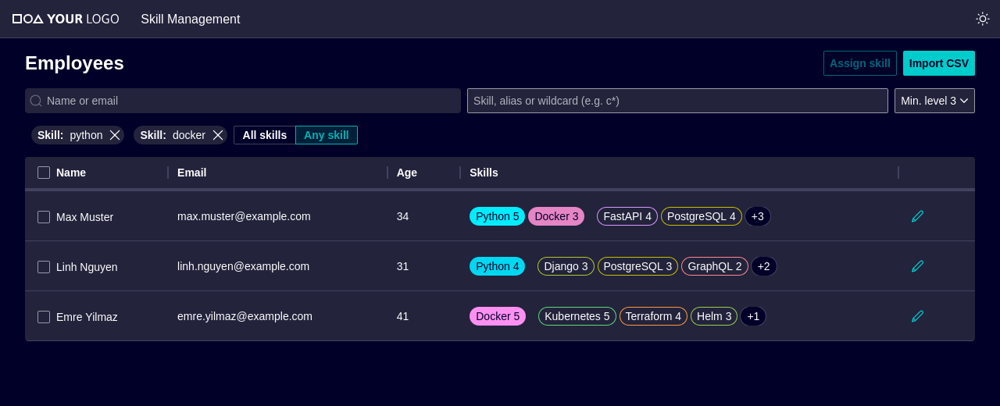

# Skill Management

Web app for team leads: import employees from a CSV file, see them in a table,
assign skills with a proficiency level and search employees by skill and level.

Take-home assignment. Requirements, data model and the decisions behind them
are documented in [NOTES.md](NOTES.md).


## Quick start

Requires Docker with Compose.

```sh
docker compose up --build
```

Open http://localhost:8090.

The first start builds the image, creates the database schema and loads the
skill catalog (100 skills from `backend/data/skills.csv`). The employee list
starts empty: click **Import CSV** and upload `backend/data/employees.csv`
(12 sample employees) to get going.

| URL                            | What                      |
| ------------------------------ | ------------------------- |
| http://localhost:8090          | The application           |
| http://localhost:8090/api/docs | Interactive API reference |

### Try it

Who knows Kubernetes at an advanced level?

1. Click **Import CSV** and upload `backend/data/employees.csv`.
2. Tick three employees and click **Assign skill**.
3. Pick `Kubernetes`, set level 4 and assign.
4. Open http://localhost:8090/?skills=kubernetes&min_level=4: the table shows
   these three employees.

## What it does

| Requirement         | In the app                                                                                             |
| ------------------- | ------------------------------------------------------------------------------------------------------ |
| 1. Employee import  | **Import CSV** uploads a file. Valid rows are created or updated by e-mail, invalid rows are reported with their line number. |
| 2. Employee overview | Table with name, e-mail, age and skill badges. Each badge shows skill and level, e.g. `Python 4`.      |
| 3. Skill assignment | The pencil in a row manages all skills of one employee. Tick several rows and use **Assign skill** to give one skill to many, with a preview of who already has it. |
| 4. Skill search     | Filter bar above the table: name or e-mail, one or more skills (name, alias or wildcard like `c*`), all or any of them, and a minimum level. |

Details worth knowing:

- The search lives in the URL, so a filtered view survives a reload and can be
  shared as a link, for example `/?skills=kubernetes&min_level=4`.
- With an active search, the skills that caused the match come first and stay
  filled; the other skills are shown as outlines.
- Each skill has its own badge color, derived from its name. The level sets how
  strong the color is and is always printed as a number too.
- Light and dark mode: the button in the header switches, the choice is stored.



### CSV format

```csv
Lastname,Firstname,E-Mail,Age,Address
Muster,Max,max.muster@example.com,34,Musterstrasse 1 80331 Munich
```

`lastname`, `firstname`, `e-mail` and `age` are required. Other columns are
ignored, comma and semicolon are both accepted as delimiter.

## Tech stack

| Area     | Choice                                              |
| -------- | --------------------------------------------------- |
| Backend  | Python 3.13, FastAPI, SQLAlchemy, Alembic, uv       |
| Database | PostgreSQL 18                                       |
| Frontend | Angular 22, Siemens Element, TypeScript             |
| Tests    | pytest (backend), Vitest (frontend)                 |
| Quality  | ruff, ESLint, Prettier, run as pre-commit hooks     |
| Delivery | One Docker image: the API also serves the frontend  |

## Project layout

```
backend/                  FastAPI application
  src/skill_management/   API, models, CSV import, seed script
  alembic/                Database migrations
  data/                   skills.csv (seed), employees.csv (sample import)
  tests/                  pytest suite, runs against PostgreSQL
frontend/                 Angular application
  src/app/api/            HTTP services and types
  src/app/employees/      Overview table, filter bar and the three dialogs
  src/app/skills/         Skill picker, levels, badge colors
  src/styles/             Theme and color tokens
Dockerfile, compose.yaml  Image and local services
NOTES.md                  Requirements, data model, decisions
```

## API

In the Docker image every path is prefixed with `/api`.

| Method | Path                      | Purpose                              |
| ------ | ------------------------- | ------------------------------------ |
| POST   | `/employees/import`       | CSV upload, returns an import report |
| GET    | `/employees`              | Overview and search                  |
| PUT    | `/employees/{id}/skills`  | Set all skills of one employee       |
| POST   | `/skill-assignments/bulk` | Assign one skill to many employees   |
| GET    | `/skills?q=`              | Skill catalog, used for autocomplete |

## Development

Requires [uv](https://docs.astral.sh/uv/), Node.js 24 and Docker.

```sh
# Database (host port 5433)
docker compose up -d db

# Backend on http://localhost:8000
cd backend
uv sync
uv run alembic upgrade head
uv run seed-skills data/skills.csv
uv run uvicorn skill_management.main:app --reload

# Frontend on http://localhost:4200, in a second terminal
cd frontend
npm install
npm start
```

The frontend dev server forwards `/api/*` to the backend on port 8000.

### Tests and checks

| Task                | Command                                 |
| ------------------- | --------------------------------------- |
| Backend tests       | `cd backend; uv run pytest`             |
| Backend lint        | `cd backend; uv run ruff check .`       |
| Frontend tests      | `cd frontend; npm test -- --watch=false` |
| Frontend lint       | `cd frontend; npm run lint`             |
| All pre-commit hooks | `uvx pre-commit run --all-files`       |

The backend tests need the database from `docker compose up -d db`. They build
the schema through the migrations and roll every test back, so they leave no
data behind.

Install the hooks once per clone with `uvx pre-commit install`.

### Continuous integration

GitHub Actions runs three jobs on every push to `main` and on pull requests,
see [.github/workflows/ci.yml](.github/workflows/ci.yml):

- **Backend:** ruff lint and format check, pytest against PostgreSQL
- **Frontend:** ESLint, Prettier check, Vitest and a production build
- **Docker image:** builds the image, starts it with Compose and checks that the
  frontend is served, the skill catalog is seeded and the sample CSV imports

## Reset data

Remove all employees and their skill assignments, keep the skill catalog:

```sh
docker compose exec db psql -U skills -c "TRUNCATE employee CASCADE"
```

Start from scratch, including the skill catalog. This deletes the database
volume; the next start recreates schema and catalog:

```sh
docker compose down -v
```

## Use of AI

Built spec-driven with Claude Code as a pair programmer. I wrote the
requirements, data model and decisions down in [NOTES.md](NOTES.md) first; the
agent implemented against that spec under the rules in [CLAUDE.md](CLAUDE.md):
plan before editing, no commits, no test edits to make them pass. I reviewed and
committed every change myself.

## Scope

Left out on purpose, see "Out of scope" in [NOTES.md](NOTES.md):

- Authentication and roles: the team lead is the only user
- Pagination
- Editing or deleting employees in the UI
- Assignment history
- Creating new skills in the UI: the catalog comes from the seed file
