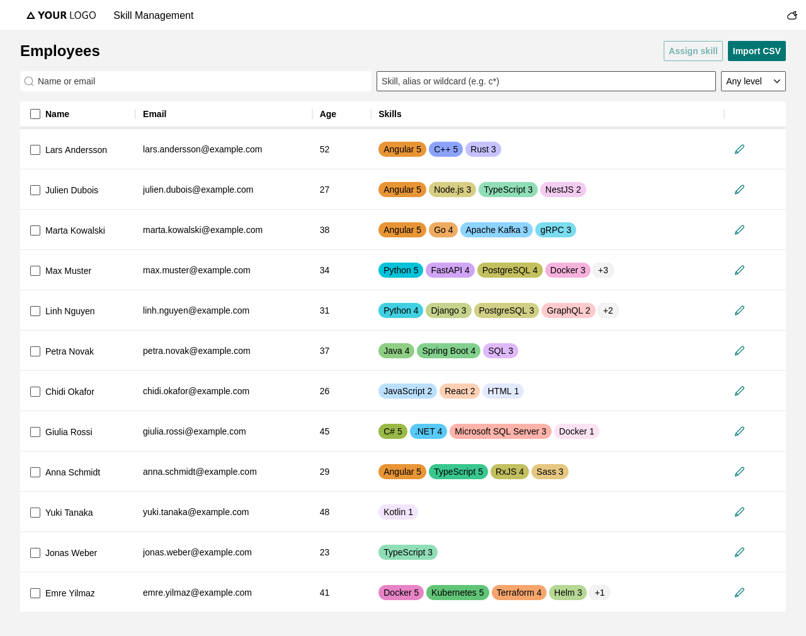

# Company Skill Management

Web app for team leads: import employees from a CSV file, see them in a table,
assign skills with a proficiency level and search employees by skill and level.

Built as a take-home assignment for a job application: the company gave four
requirements (CSV import, employee table, skill assignment, skill search) and
left the rest open. The requirements, the data model and the decisions behind
them are in [NOTES.md](NOTES.md).

The main implementation is Python + Angular. The same API and UI also exist as
Vue, React and Spring variants, see
[Other stacks](#other-stacks).

<div align="center">

### 🚀 Live demo

[](https://skills-web-angular.onrender.com)
[](https://skills-web-vue.onrender.com)

⏳ The first request can take about 1 minute (free tier, the backend sleeps).<br>
🔄 Demo data is reset daily at 03:00 UTC.<br>
🔓 No login: please do not upload real personal data.

</div>



## Quick start

Requires Docker with Compose.

```sh
docker compose up --build
```

Open http://localhost:8090.

The first start builds the image, creates the database schema and loads the
skill catalog (100 skills from `backend/data/skills.csv`). The employee list
starts empty, see [Try it](#try-it) below.

| URL                            | What                      |
| ------------------------------ | ------------------------- |
| http://localhost:8090          | The application           |
| http://localhost:8090/api/docs | Interactive API reference |

### Try it

Who knows Kubernetes at an advanced level? This works the same in the
[live demo](https://skills-web-angular.onrender.com) and locally. You need the
sample file `backend/data/employees.csv` from this repository.

1. Click **Import CSV**, choose `backend/data/employees.csv` (12 sample
   employees) and click **Upload**.
2. Tick three employees and click **Assign skill (3)**.
3. Pick `Kubernetes`, select **4 - Advanced** and click **Assign**.
4. In the filter bar, type `kub` into the skill field and pick **Kubernetes**,
   then choose **Min. level 4 (Advanced)**: the table shows these three employees.

The search is now in the URL (`/?skills=kubernetes&min_level=4`), so the result
can be shared as a link.

## What it does

| Requirement         | In the app                                                                                             |
| ------------------- | ------------------------------------------------------------------------------------------------------ |
| 1. Employee import  | **Import CSV** uploads a file. Valid rows are created or updated by e-mail, invalid rows are reported with their line number. |
| 2. Employee overview | Table with name, e-mail, age and skill badges. Each badge shows skill and level, e.g. `Python 4`.      |
| 3. Skill assignment | The pencil in a row manages all skills of one employee. Tick several rows and use **Assign skill** to give one skill to many, with a preview of who already has it. |
| 4. Skill search     | Filter bar above the table: name or e-mail, one or more skills (name, alias or wildcard like `c*`), all or any of them, and a minimum level. |

Details worth knowing:

- The search lives in the URL, so a filtered view survives a reload and can be
  shared as a link, for example `/?skills=kubernetes&min_level=4`.
- With an active search, the skills that caused the match come first and stay
  filled; the other skills are shown as outlines.
- Each skill has its own badge color, derived from its name. The level sets how
  strong the color is and is always printed as a number too.
- Light and dark mode: the button in the header switches, the choice is stored.


### CSV format

```csv
Lastname,Firstname,E-Mail,Age,Address
Muster,Max,max.muster@example.com,34,Musterstrasse 1 80331 Munich
```

`lastname`, `firstname`, `e-mail` and `age` are required. Other columns are
ignored, comma and semicolon are both accepted as delimiter. The assignment
gives no file format; this one is my assumption of a plain employee list.

## Tech stack

| Area     | Choice                                              |
| -------- | --------------------------------------------------- |
| Backend  | Python 3.13, FastAPI, SQLAlchemy, Alembic, uv       |
| Database | PostgreSQL 18                                       |
| Frontend | Angular 22, Siemens Element, TypeScript             |
| Tests    | pytest (backend), Vitest (frontend)                 |
| Quality  | ruff, ESLint, Prettier, run as pre-commit hooks     |
| Delivery | One Docker image: the API also serves the frontend  |

Vue, Spring and React are covered under [Other stacks](#other-stacks).

## Project layout

```
backend/                  FastAPI application
  src/skill_management/   API, models, CSV import, seed script
  alembic/                Database migrations
  data/                   skills.csv (seed), employees.csv (sample import)
  tests/                  pytest suite, runs against PostgreSQL
frontend/                 Angular application
  src/app/api/            HTTP services and types
  src/app/employees/      Overview table, filter bar and the three dialogs
  src/app/skills/         Skill picker, levels, badge colors
  src/styles/             Theme and color tokens
backend-spring/           Spring Boot variant of the API
frontend-vue/             Vue variant of the frontend
frontend-react/           React variant of the frontend
Dockerfile, compose.yaml  Image and local services
render.yaml               Blueprint for the live demo
NOTES.md                  Requirements, data model, decisions
```

### Other stacks

The backends serve the same API and the frontends talk to it under `/api`, so
they can be combined. Compose starts one backend and one frontend by name:

```sh
docker compose up --build api-python web-vue   # or api-spring, web-angular, web-react
```

Open http://localhost:8091. Start only one backend and one frontend at a time.
The live demo runs Python with Angular and with Vue.

## API

In the Docker image every path is prefixed with `/api`.

| Method | Path                      | Purpose                              |
| ------ | ------------------------- | ------------------------------------ |
| POST   | `/employees/import`       | CSV upload, returns an import report |
| GET    | `/employees`              | Overview and search                  |
| PUT    | `/employees/{id}/skills`  | Set all skills of one employee       |
| POST   | `/skill-assignments/bulk` | Assign one skill to many employees   |
| GET    | `/skills?q=`              | Skill catalog, used for autocomplete |
| GET    | `/health`                 | Liveness check, no database access   |

## Development

Requires [uv](https://docs.astral.sh/uv/), Node.js 24 and Docker.

```sh
# Database (host port 5433)
docker compose up -d db

# Backend on http://localhost:8000
cd backend
uv sync
uv run alembic upgrade head
uv run seed-skills data/skills.csv
uv run uvicorn skill_management.main:app --reload

# Frontend on http://localhost:4200, in a second terminal
cd frontend
npm install
npm start
```

The frontend dev server forwards `/api/*` to the backend on port 8000.

### Tests and checks

| Task                | Command                                 |
| ------------------- | --------------------------------------- |
| Backend tests       | `cd backend; uv run pytest`             |
| Backend lint        | `cd backend; uv run ruff check .`       |
| Frontend tests      | `cd frontend; npm test -- --watch=false` |
| Frontend lint       | `cd frontend; npm run lint`             |
| All pre-commit hooks | `uvx pre-commit run --all-files`       |

The backend tests need the database from `docker compose up -d db`. They build
the schema through the migrations and roll every test back, so they leave no
data behind.

Install the hooks once per clone with `uvx pre-commit install`.

### Continuous integration

GitHub Actions runs three jobs on every push to `main` and on pull requests,
see [.github/workflows/ci.yml](.github/workflows/ci.yml):

- **Backend:** ruff lint and format check, pytest against PostgreSQL
- **Frontend:** ESLint, Prettier check, Vitest and a production build
- **Docker image:** builds the image, starts it with Compose and checks that the
  frontend is served, the skill catalog is seeded and the sample CSV imports

A second workflow deploys the image to AWS. It is started by hand and never on a
push, see [Deployment](#deployment).

## Live demo

Hosted on Render (free tier) with a Neon database. Both frontends use the same
Python backend and forward `/api` to it. The setup is described in
[render.yaml](render.yaml); the daily reset is
[.github/workflows/reset-demo.yml](.github/workflows/reset-demo.yml). The Spring
backend and the React frontend are prepared there as commented blocks.

## Deployment

The image ran on AWS ECS Fargate. I set the environment up once with the AWS CLI
to try it and removed it afterwards, so nothing is running. The workflow that
deployed to it is in the repository.

**What exists:** [.github/workflows/deploy.yml](.github/workflows/deploy.yml),
started by hand from the Actions tab.

1. GitHub Actions assumes an IAM role through OIDC. No access keys are stored,
   and the role accepts only the `main` branch.
2. The image is built and pushed to ECR, tagged with the commit SHA.
3. The current task definition is fetched from ECS, gets the new image and is
   deployed; the job waits until the service is stable.

| Piece         | Setup in the test environment                                                                    |
| ------------- | ------------------------------------------------------------------------------------------------ |
| Runtime       | ECS Fargate service behind an Application Load Balancer, health check on `GET /api/health`       |
| Network       | Only the load balancer was public, over HTTP; the task accepted traffic from the load balancer only |
| Database      | RDS for PostgreSQL, reachable from the task only                                                 |
| Configuration | `DATABASE_URL` as a plain environment variable in the task definition, never in the repository   |
| Migrations    | Run in the container entrypoint on every start                                                   |

**What I would change for production:**

- HTTPS and the company login (OIDC) at the load balancer. The app has no
  authentication, and the test environment was reachable without login; that is
  acceptable for sample data and a few hours only.
- `DATABASE_URL` from Secrets Manager instead of a plain environment variable.
- Migrations as a one-off ECS task before the service update. In the entrypoint
  they race when several tasks start together.
- Deploy on a version tag and only after CI passed, instead of by hand.
- A readiness check that queries the database; `/api/health` is a liveness
  check only.
- The infrastructure described as code instead of set up by CLI commands.

## Reset data

Remove all employees and their skill assignments, keep the skill catalog:

```sh
docker compose exec db psql -U skills -c "TRUNCATE employee CASCADE"
```

Start from scratch, including the skill catalog. This deletes the database
volume; the next start recreates schema and catalog:

```sh
docker compose down -v
```

## Use of AI

Built spec-driven with Claude Code as a pair programmer. I wrote the
requirements, data model and decisions down in [NOTES.md](NOTES.md) first; the
agent implemented against that spec under the rules in [CLAUDE.md](CLAUDE.md):
plan before editing, no test edits to make them pass, commits only when I ask.
I reviewed every change before it was committed.

## Scope

Left out on purpose, see "Out of scope" in [NOTES.md](NOTES.md):

- Authentication and roles: the team lead is the only user
- Pagination
- Editing or deleting employees in the UI
- Assignment history
- Creating new skills in the UI: the catalog comes from the seed file

## Known limitations

Built as a demo for one user. Before real use I would address:

- **CSV upload:** no limit on file size, row count or the length of names; the
  file is read into memory. Meant for files of a few thousand rows.
- **CSV encoding and quotes:** the file must be UTF-8, so an Excel export saved
  as Windows-1252 is rejected as a whole. An unclosed quote swallows the rows
  after it, and the report counts them as one error.
- **Search and bulk input:** no upper bound on the length of the search text,
  the number of skill terms or the number of employee ids. Extreme input can
  end in a 500 instead of a 422.
- **Concurrent writes:** two requests creating the same assignment or employee
  at the same moment end in a 500 instead of a 409.
- **Network exposure:** Compose publishes the app and the database on all host
  interfaces with a development password.
